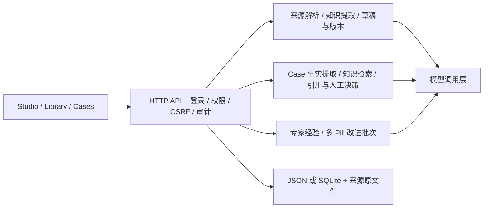

# AssetOps Intelligence Pill

以版本化领域知识包（Pill）为核心的资产运营工作台：把资料与专家经验整理为可发布的知识，在 Case 对话中引用知识，并把新的专家经验转化为可审核的改进方案。

> 更新日期：2026-10-16。本文依据 `4df2ddc` 加本地修复后的工作区编写，包含尚未提交的修改。项目阶段为本地 MVP。

## 1. 安装与启动

要求 **Node.js >=24.0.0**、npm。本轮验证使用 Node.js **24.21.0**。

在项目根目录安装锁定版本的依赖：

```powershell
npm ci
```

首次配置时，从 `.env.example` 创建 `.env`；已有 `.env` 时保留原配置：

```powershell
if (!(Test-Path .env)) { Copy-Item .env.example .env }
```

编辑 `.env`，填写模型服务的 HTTPS 地址、密钥及模型名。不要提交 `.env`：

```dotenv
SOCLAAS_BASE_URL=https://your-provider.example/v1
SOCLAAS_API_KEY=
SOCLAAS_MODEL=default
STORAGE_DRIVER=json
```

服务通过兼容 Chat Completions 的接口调用模型。未配置模型时仍可保存 Case、编辑草稿，但 Case 智能对话、知识提取及改进分析需要有效的模型配置。配置读取自项目根目录的 `.env`，修改后需重启服务。

**仅首次创建管理员时**，在服务停止、账号库为空的情况下运行；终端会提示输入密码，长度为 12–128 字符：

```powershell
npm run admin -- bootstrap admin "Administrator"
```

已有账号无需重复初始化。启动并访问 [本地工作台](http://127.0.0.1:5173)：

```powershell
npm run dev
```

`npm start` 使用相同的 `node server.js` 入口。默认地址为 `127.0.0.1:5173`，可使用 `HOST`、`PORT` 覆盖。忘记密码时，先停止服务，再执行 `npm run admin -- reset-password <username>`。

## 2. 当前界面与操作流程

顶层导航按顺序为 **Pill Studio、Pill Library、Case Workspace**，另有 Settings。默认打开 Studio。

| 入口 | 路径 | 当前功能 |
|---|---|---|
| Pill Studio | `/studio` | 合并展示普通草稿和 Case 改进方案；按文字、Owner、Source 筛选 |
| 创建 Pill | `/studio/new` | 上传资料、填写专家经验，或同时提供两者，提取后进入草稿预览 |
| 草稿预览 | `/studio/:id` | 查看知识内容；有权限的用户可编辑、保存、删除，管理员可发布 |
| 改进方案 | `/studio/improvements/:caseId/:batchId` | 查看多个 Pill 的改动前后对照、修改正文、接受或排除改动、发布或关闭 |
| Pill Library | `/library` | 搜索已发布知识，查看生效版本、发布时间及历史版本 |
| Pill 详情与比较 | `/library/:id`、`/library/:id/compare` | 内容、贡献与发布身份、版本比较及管理员版本操作 |
| Case Workspace | `/cases`、`/cases/new`、`/cases/:id` | Case 列表、统一事件对话、附件引用、人工决策、专家经验及摘要 |
| Settings | `/settings` | 账号、退出、修改密码；管理员账号管理 |

当前 Studio 使用内容预览和编辑界面，**不再展示旧版“准备—评测—发布”三阶段标签页**。Case 使用统一对话，底部有 Expert experience confirmation 和 Summary 两个折叠面板；审核决策表单显示在对应的对话消息旁。

兼容路径说明：

- `/`、`/dashboard`、`/overview`、`/learning`、`/governance` 和 `/studio/improvements` 归一到 `/studio`。
- `/overview/analytics` 归一到 `/studio/analytics`，当前仍显示 Studio 列表，不是独立统计页面。
- `/studio/new/upload`、`/studio/new/expert` 归一到统一创建入口。
- 旧 `/incidents`、`/triage/:id`、`/review/:id` 链接映射到 Case 路径；当前页面由统一对话承载，不应把旧链接视为仍有独立 Triage、审核或任务界面的证明。

### 2.1 从资料创建 Pill

```text
上传资料 / 填写专家经验
  → 保存来源并调用 AI 提取
  → 将已提取来源整理为草稿
  → 预览知识 → 编辑并保存
  → 管理员发布 → Library 中的生效版本
```

- 支持 PDF、DOCX、UTF-8 TXT、Markdown、PNG、JPEG；扫描 PDF 和图片依赖本地 OCR。
- 创建表单可以同时接收文件和专家经验；提取失败后可重试已有来源，避免重复创建或上传。
- 上传解析和模型提取在后端是两个步骤；当前创建表单会连续执行它们。
- 有编辑权限的用户打开草稿时，系统会为尚未应用的已提取来源调用 `prepare-draft`，随后展示草稿预览；已应用来源不会重复追加。
- 预览以 Scope、Actions、Decision rules、Operating limits 为主；点击 Edit 后可修改内容、增加或移除条目。
- 来源、候选知识、引用位置、升级条件等信息仍保存在记录中，不是全部都显示在简化编辑器里。
- 提取不完整时保留来源、已有草稿和问题，不能把模型提取或自动整理等同于人工验证。

**当前发布规则：只有管理员可发布。** 发布前执行草稿结构检查，并整理路由及规则—行动关联，生成新的发布快照。普通 Studio 发布记录为 `admin_direct_publication`；现有模型评测结果可保留，但不作为当前发布路径的硬门槛，也不再强制贡献者与发布者分离。

### 2.2 Case 对话、引用与人工决策

```text
描述事件 / 选择附件提问
  → 提取并累积事实 → 检索生效 Pill 的相关规则与行动
  → 验证引用和问题覆盖 → 回答、追问或转交人工
  → 必要时记录审核决定 / 专家经验
  → 保存可追溯的对话与摘要
```

- 系统提取位置、资产、类别、时间、影响、观察、已做行动和受影响范围等字段。
- 手动字段受保护；新信息与已确认事实冲突时，保留原值并显示 Keep current / Use new value。未解决冲突会阻止服务端最终提交。
- 兼容 API 中仍有事件摘要编辑和 finalize；当前紧凑对话页不展示独立摘要编辑器或 Confirm & submit 按钮。
- Case 对话按类别、资产等适用条件筛选已批准 Pill，再按问题与规则、行动的词汇相关性排序，保留关联的前置条件。不是向量检索。
- 当前对话最多取前 8 个匹配 Pill；保留额外匹配数量。该路径与后端旧版多 Pill Triage 编排的限制不同。
- 附件可作为回答的引用来源，但不会自动变成已确认 Case 事实，也不能单凭附件证明操作已获 Pill 支持。
- 区分问题覆盖、操作审批与安全升级。Reviewer / Admin 可记录消息对应的批准、拒绝或升级；安全升级请求仅允许记录升级。
- 专家答复不等于操作批准；审批记录不等于执行，自动摘要不等于已验证结果或 Case 关闭。
- 消息失败时保留输入和错误诊断，可重试；请求 ID 用于避免重复消息和重复经验提交。

### 2.3 专家经验生成多 Pill 改进方案

```text
Case 触发专家请求 → 专家提交经验
  → 自动建立改进批次并分析当前生效知识
  → Studio 展示需要更新 / 新建的 Pill
  → 逐项接受或排除，必要时编辑 After 文本
  → 管理员发布选定改动，或全部排除后关闭
```

当前正常提交流程**不需要再点击一次经验确认**。保留 `expert-experience-confirmation` 接口，用于历史记录、重试和兼容处理。

- 提案可修改 Scope、Actions、Decision rules、Operating limits；每项包含改动前后文本、原因及专家原文引用。
- 一次方案最多 8 个目标，每个目标最多 12 项改动；可以更新现有 Pill，也可提出必要的新 Pill。
- 每项必须明确接受或排除，不能带着 pending 决策发布；新 Pill 至少需要范围、行动和决策规则。
- 关联依赖须一起接受并发布；目标版本、修订或可编辑草稿发生变化时，旧方案不能直接发布，需要重新分析。
- Expert / Admin 可编辑和保存方案；**仅 Admin 可发布**。此路径记录 `admin_batch_review`，不把独立模型评测作为发布门槛。
- 没有需要修改的内容时标记 `no_changes`，可关闭方案；重新分析会替换当前提案编辑，历史提案保留在记录中。
- SQLite 模式下，批次发布与 Case 回执通过事务提交；JSON 模式下多个 Pill 的写入在同一次记录替换中完成，Case 回执通过发布凭据重试恢复，不声称具备跨文件事务。

## 3. 角色和权限

账号支持组合角色；以下描述单个角色的主要能力。服务端也会校验权限和登录身份。

| 角色 | 主要权限 |
|---|---|
| `viewer` | 读取当前工作区业务信息 |
| `operator` | Case 录入、消息和附件、兼容 Triage/处理/学习及任务执行接口 |
| `expert` | 创建和编辑未发布知识、来源提取、提交专家经验、编辑改进方案；不能发布 |
| `reviewer` | Case 建议的审核与安全升级、兼容人审和任务验证接口；不能发布 Pill 或切换 Library 版本 |
| `admin` | 全部角色能力、知识及改进批次发布、已发布知识编辑与版本管理、账号和系统管理 |

已发布知识及带有发布历史的草稿仅管理员可编辑；修改已发布版本时先建立新草稿，历史快照保留。管理员可以发布自己参与编写的内容，当前没有强制双人发布审核。

所有账号共享一个业务工作区，没有按租户、楼宇或资产隔离。记录中的 Owner、负责人等文本不等于独立的资源访问控制。Case 决策和发布身份绑定登录账号，不信任前端自报身份。

密码采用加盐 scrypt，会话最长 8 小时，账号变更会撤销对应会话；写请求需要 CSRF token。JSON 会话重启失效，SQLite 会话可跨同机实例共享；备份恢复会清除运行会话。HTTPS 部署应设置 `COOKIE_SECURE=true`。

## 4. 架构与代码入口

Node.js 原生 HTTP 服务同时提供静态前端和 JSON API。前端为 HTML、CSS、原生 JavaScript ES Modules，无 React / Vue。



| 模块 | 代码入口 | 职责 |
|---|---|---|
| HTTP / 认证 | `server.js`、`application.js`、`auth.js` | 路由、会话、角色、CSRF、审计和系统管理 |
| 当前前端 | `public/app.js`、`public/studio.js`、`public/pill-preview.js`、`public/improvements.js`、`public/case-chat.js` | 路由、知识预览、批次审核和统一事件对话 |
| Case 输入 | `intake-agent.js`、`conversation.js`、`intake.js` | 事实提取、人工字段保护、冲突和消息状态 |
| Case 智能回答 | `case-conversation-agent.js`、`case-knowledge.js` | 检索相关条目、验证引用及问题级知识覆盖 |
| 操作与结果边界 | `case-supervision.js`、`case-operation-policy.js`、`case-feedback.js`、`case-records.js` | 人工介入判定、审核记录、摘要、专家经验 |
| 来源与知识提取 | `document-parser.js`、`ocr.js`、`knowledge-agent.js` | 文本/OCR 解析、来源证据、候选知识和不完整提取恢复 |
| Pill 与发布 | `pill-studio.js`、`pill-draft.js`、`pill-versions.js` | 草稿、自动整理、结构与路由处理、发布快照和版本比较 |
| 改进批次 | `improvements.js`、`improvement-plan.js`、`pill-batch.js` | 基于专家经验生成提案、逐项决策、批次发布与恢复 |
| 模型通信 | `model-runtime.js`、`config.js` | 服务端配置、并发限制、超时、熔断及响应大小限制 |
| 存储与运行 | `incident-store.js`、`database.js`、`runtime.js`、`storage-operations.js` | 修订校验、事务、备份、迁移、实例协调和停机恢复 |

模型驱动部分包括事实提取、Case 回答、知识提取、专家访谈、领域 Triage、跨 Pill 协调、学习及改进方案生成。它们是后端函数和提示词封装，不是独立运行的自治服务。治理、引用检查、权限和状态校验主要由确定性代码完成。

### 保留的后端能力与兼容模块

以下实现仍在仓库和 API 中，但不是当前主导航中的独立工作区：

- 多 Pill Triage、报告历史和报告问答，领域规则与引用校验，以及跨 Pill 冲突/依赖协调。
- 正式人审、任务分派、执行证据、结果验证、学习建议审核与导入。
- 模型评测、重复试验、候选与基准比较、专家复核及专家示例工作流。
- 运营指标、版本表现和 CSV 导出。

对应模块包括 `triage.js`、`triage-agent.js`、`coordination-agent.js`、`review.js`、`tasks.js`、`learning.js`、`pill-evaluation.js`、`expert-workflow.js` 和 `operations-metrics.js`。这些能力不能据此描述为当前页面已暴露完整入口，也不能把旧评测规则当成当前管理员直接发布的规则。

## 5. 数据、配置与恢复

默认存储模式为 **JSON**，SQLite 需要显式迁移后启用。

| 数据 | JSON 模式 | SQLite 模式 |
|---|---|---|
| Case、消息、专家经验、改进批次 | `data/incidents.json` | `data/assetops.sqlite` |
| Pill 草稿、发布版本、来源记录 | `data/pills.json` | `data/assetops.sqlite` |
| 账号 | `data/users.json` | `data/assetops.sqlite` |
| Pill 上传原文件 | `data/pills.json.uploads/` | 同左 |
| 请求审计 | `data/audit/` | 同左 |
| 备份 | `backups/`，停机 CLI | `backups/`，支持在线及定时备份 |

SQLite 使用 WAL、事务、修订校验和同机实例租约；JSON 为单进程兼容模式。文件和审计不属于 SQL 原子事务。种子知识在 `pills/ahu-cooling.json`，初始示例不能视作已经批准的工程 SOP。

停止全部实例后，迁移并在 `.env` 中设置 `STORAGE_DRIVER=sqlite`：

```powershell
npm run admin -- migrate-sqlite
```

迁移前自动备份并保留原 JSON。数据库已存在时禁止误以 JSON 模式启动；SQLite 模式不支持自定义 `DATA_FILE`、`PILL_DATA_FILE`。

常用停机管理命令：

```powershell
npm run admin -- backup
npm run admin -- restore "<backup-directory>" --confirm
```

恢复会校验备份路径、大小和摘要，并保留原数据目录。SQLite 的在线备份通过管理员接口触发，也可由应用进程定时执行，默认每 360 分钟一次、保留 7 份；对应 `BACKUP_INTERVAL_MINUTES`、`BACKUP_KEEP`。

OCR 默认关闭。启用时设置 `OCR_ENABLED=true`，安装 Tesseract 和 Poppler，并配置 `OCR_LANGUAGE`；工具不在 PATH 时设置 `TESSERACT_PATH`、`PDFTOPPM_PATH`。

解析限制：单文件 10 MB、PDF 最多 100 页、提取文字最多 60,000 字符；每次 OCR 最多 5 个扫描页。Case 最多 5 个附件，累计提取文字最多 120,000 字符。复杂表格、图纸含义和 OCR 数值仍需人工核对。

运行时提供模型并发限制、熔断、请求审计及 `/healthz`。备份未加密且未异地复制，审计不防篡改；定时备份依赖服务进程运行，同机 SQLite 协调不等于跨主机高可用。

`data/`、`backups/`、`node_modules/`、`.env` 已列入忽略规则，勿将真实业务数据或密钥提交到版本库。

## 6. 主要 API

| 用途 | 代表接口 |
|---|---|
| 登录、会话、密码 | `/api/auth/login`、`/api/auth/session`、`/api/auth/password` |
| Case 与消息 | `/api/incidents`、`/api/incidents/:id/messages`、`/api/incidents/:id/finalize` |
| Case 附件 | `/api/incidents/:id/documents`、`/api/incidents/:id/document-questions` |
| 人工决定与专家经验 | `/api/cases/:id/confirmations`、`/expert-solutions`、`/expert-experience-confirmation`、`/result-summary` |
| Studio | `/api/studio`、`/api/studio/:id/prepare-draft`、`/save`、`/publish`、`/fork`、`/delete` |
| 来源提取 | `/api/studio/:id/documents`，以及具体文档的 `/analyze`、`/merge` |
| 改进批次 | `/api/improvements`、`/api/improvements/:caseId/:batchId`，以及 `/analyze`、`/save`、`/publish`、`/close` |
| Library | `/api/library`、`/api/library/:id`、`/compare`，以及具体版本的 `/activate`、`/disable`、`/restore` |
| 兼容分析、人审与任务 | `/api/triage/:id/runs`、`/api/review/:id`、`/api/cases/:id/tasks` |
| 兼容学习、评测与统计 | `/api/learning`、`/api/studio/:id/evaluate`、`/api/operations`、`/api/operations/export` |
| 管理 | `/api/admin/users`、`/api/admin/health`、`/api/admin/audit`、`/api/admin/storage`、`/api/admin/storage/backup` |

简写操作共享对应资源的前缀，例如 Case 专家经验接口为 `/api/cases/:id/expert-solutions`，Studio 保存接口为 `/api/studio/:id/save`。写接口通常需要当前 `revision`；批次修订号与 Case 修订号分别校验。登录身份和角色由服务端注入，不能通过请求正文伪造。

## 7. 测试与本轮验证

安装完整依赖后运行：

```powershell
npm test
```

2026-10-16 本地修复后的全量结果：**575 项测试，574 项通过、0 项失败、1 项跳过**。跳过项是 Windows 沙箱不允许创建符号链接或 junction 的备份测试子项；备份完整性和路径校验测试仍执行。

受限环境下若系统临时目录报权限错误，可将测试临时目录改到当前可写工作区；不要指向真实业务数据：

```powershell
New-Item -ItemType Directory -Force .test-tmp | Out-Null
$env:TEMP = (Resolve-Path .test-tmp).Path
$env:TMP = $env:TEMP
npm test
```

本轮修复覆盖：

- 手动时间、标题、位置、设备、观察和受影响范围的保护与冲突处理。
- 对话中保留或采用新值，以及服务端阻止未解决冲突的最终提交。
- 消息关联的审核和安全升级入口。
- 旧学习入口归一到 Studio。
- 当前 Studio 来源整理、失败重试、修订传递及权限测试；发布权限和中文报告证据测试同步到当前实现。

自动化测试使用临时数据和模拟模型响应；本轮未启动浏览器验收、未调用真实模型、未执行真实设备或外部工单操作。`npm run check:llm`、`check:triage`、`check:knowledge` 是另行执行的模型检查脚本，需要真实服务配置，不能用上述测试通过结果代替连通性和业务质量验证。

## 8. 实现边界与补充文档

当前没有实时 BMS / IoT 资产接入、外部工单双向同步、向量索引、租户隔离、跨主机集群或自主设备操作。词汇匹配、引用检查和结构校验不能证明工程诊断正确，专家经验和自动摘要也不能证明操作已执行或结果已验证。

当前准确定位是：**以版本化领域知识为核心，结合模型辅助回答、人工决策与可追溯知识改进的资产运营工作台 MVP。**

补充说明见 [Case 对话设计](docs/case-conversation.md)、[数据与评测操作指南](docs/data-and-evaluation.md)、[安全与运维说明](docs/security-and-operations.md)。补充文档包含历史工作流说明；当前导航、发布权限和发布门槛以本 README 及现有 `public/app.js`、`auth.js`、`pill-studio.js`、`pill-batch.js` 的实现为准。
