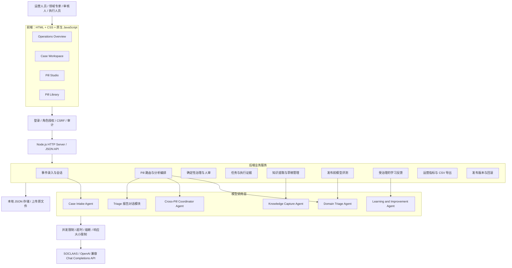

# AssetOps Intelligence Pill：当前架构与功能报告

> 整理日期：2026-10-12  
> 代码基线：`ffecbe2` 加本次本地开发增量，尚未提交或推送  
> 项目阶段：具备受治理知识闭环的本地 MVP  
> 范围：基于当前代码实现，不将规划功能、模型能力假设或比赛要求视为已实现功能。

## 1. 项目定位

AssetOps Intelligence Pill 面向资产运营中的事件处理与专家知识复用。系统把资料和专家经验整理为可审核、可发布、可追溯的 Pill，在事件分析中调用，并根据实际处理结果形成新的知识改进建议。

它不是仅提供回答的聊天机器人，也不是自动控制设备的平台。对话用于收集事实和解释分析；结构化记录、证据校验、人工决策、任务流转和版本管理承担业务闭环。

核心流程：

```text
上传资料 / 录入专家经验
  → 提取候选知识 → 人工核对 → Pill 草稿
  → 结构校验 → 模型评测（启用后必须通过）→ 专家审核 → 发布版本
  → Case 输入与确认 → 匹配 Pill → AI 分析 → 治理检查 → 人工决定
  → 分派任务 → 实际行动 → 结果验证
  → 学习建议 → 专家审核与修订 → 纳入新草稿 → 验证并发布新版本
```

没有匹配 Pill 或知识不足时，系统保留缺口并转交专家，不自动编造经验。人工处理形成的证据仍可进入学习流程。

## 2. 系统架构

### 2.1 总体架构图

以下 Mermaid 图可在支持 Mermaid 的 Markdown 查看器中渲染。



### 2.2 技术组成

| 层次 | 当前实现 | 说明 |
|---|---|---|
| 前端 | HTML、CSS、原生 JavaScript ES Modules | 无 React/Vue；通过前端路由切换工作区 |
| 服务端 | Node.js 原生 `node:http` | `server.js` 同时提供静态页面和 JSON API；不是独立微服务集群 |
| 业务逻辑 | 按事件、分析、人审、任务、知识、学习、评测、版本拆分模块 | 在同一服务进程内编排 |
| 模型接口 | OpenAI 兼容 Chat Completions | 使用 SOCLAAS 环境配置；不需要为每个 Agent 配置不同密钥 |
| PDF 提取 | `pdfjs-dist` | 读取可搜索文字、保留页码 |
| DOCX 提取 | `mammoth` | 提取文本；不保证复杂版式还原 |
| 存储 | 本地 JSON 文件及上传文件目录 | 单进程串行写入、临时文件替换、revision 冲突检查 |
| 测试 | Node.js Test Runner、JSDOM | 后端、API、DOM 交互与回归测试 |

运行要求为 Node.js `>=22.13.0`。常用命令为 `npm run dev`、`npm test`；默认监听 `127.0.0.1:5173`，可通过 `HOST`、`PORT` 配置。

### 2.3 外部服务边界

- 模型请求只从后端发出，前端不持有 API Key。
- 配置项包括 `SOCLAAS_BASE_URL`、`SOCLAAS_API_KEY`、`SOCLAAS_MODEL`；本报告不包含密钥。
- 保留 TLS 证书验证，不能通过关闭验证解决证书问题。
- 原始资料文字、Case 事实及相关上下文可能被发送给配置的模型服务，真实业务使用前需确认数据授权。
- 当前没有向量数据库、嵌入检索、独立消息队列或通用 Agent 自治框架。

## 3. Agent 与确定性模块

### 3.1 模型驱动的角色

严格按实现区分，当前有 **5 类核心 LLM Agent，加 1 个模型驱动的报告对话模块**。它们是后端函数和提示词封装，不是独立部署的微服务。

| 角色 | 代码入口 | 输入 | 输出与职责 | 权限边界 |
|---|---|---|---|---|
| Case Intake Agent | `intake-agent.js`：`createIntakeAgent` | 用户消息、现有事件字段和会话上下文 | 提取事件事实、识别更新；后端组织追问和就绪判断 | 不自行确认最终 Case；优先级由用户设置 |
| Knowledge Capture Agent | `knowledge-agent.js`：`createKnowledgeCaptureAgent` | 资料文本块、来源位置、保存的领域 | 提取范围、规则、行动、边界、升级条件、示例和缺失信息 | 候选内容必须人工核对，不能直接发布 |
| Domain Triage Agent | `triage-agent.js`：`createTriageAgent` | 确认后的 Case 快照、选中的 Pill | 提出可能原因，引用事实，选择规则及行动 ID，指出缺失信息 | 不能任意生成并执行新行动；行动正文取自 Pill 目录 |
| Cross-Pill Coordinator Agent | `coordination-agent.js`：`createCoordinationAgent` | 已验证的多领域报告和候选行动 | 识别潜在冲突、前置关系、待确认问题，生成建议顺序 | 行动 ID 与依赖环由后端验证；不能批准或执行 |
| Learning & Improvement Agent | `learning-agent.js`：`createLearningAgent` | 实际行动、验证结果、人审意见、分析记录及任务证据 | 区分知识问题、输入问题、Agent 问题和执行偏差，提出改进建议 | 不自动修改或发布 Pill；知识变化须经过专家审核 |
| Triage 报告对话模块 | `triage-agent.js`：`createTriageChat` | 选定报告、Case 和对话历史 | 回答针对该报告的依据、规则及建议的问题 | 不是新的行动授权；不能修改 Case、批准计划或执行设备操作 |

多 Pill 场景针对不同 Pill **分别调用同一个 Domain Triage Agent 实现**。全部成功后自动进行一次协调检查；协调失败保留专家报告，但阻断批准。属于有界分析编排，不是自由协商或自动执行。

### 3.2 Governance Agent 的实际实现

产品概念中的 Governance Agent，目前主要由 `review.js` 的 `governancePackage()` 承担，是**确定性治理模块**，不单独请求大模型。

已经检查的内容包括：

- Case 事实是否与报告快照一致，事件是否仍处于已确认状态。
- 当前适用的 Pill 及版本是否与报告一致。
- 报告是否完整，是否存在缺失信息、未解决冲突或待处理消息。
- 规则 ID、证据引用和行动 ID 是否通过校验。
- 行动内容是否与 Pill 目录一致，是否需要审批。
- 多 Pill 是否存在已声明的行动冲突，是否需要人工协调。
- 将阻断项、警告、边界和待审核行动整理为审核包。

它不能证明诊断正确、自动判断所有工程风险，也不是法规合规认证工具。

### 3.3 其他非 LLM 模块

| 模块 | 文件 | 当前职责 |
|---|---|---|
| 会话状态与输入检查 | `conversation.js`、`intake.js` | 字段合并、人工修改保护、冲突确认、重试与提交检查 |
| Pill 路由与协作 | `pill-routing.js` | 按条件选择 Pill，给规则和行动加来源标识，检查显式冲突 |
| 分析结果验证 | `triage.js` | 验证引用与目录边界，保存分析状态和来源快照 |
| 资料解析与合并 | `document-parser.js`、`knowledge-merge.js` | 提取文字、保留引用位置、合并已审核知识 |
| 发布前评测 | `pill-evaluation.js` | 复用 Triage Agent，按测试预期比较草稿和生效版本 |
| 任务管理 | `tasks.js` | 分派、进度、升级、证据提交、结果验证与提醒 |
| 版本治理 | `pill-studio.js`、`pill-versions.js` | 草稿、发布快照、版本比较、激活、停用与回滚 |
| 统计 | `operations-metrics.js` | 明确口径的指标、筛选、月度案例分组和 CSV 导出 |

## 4. 当前前端工作区

现在的顶层导航是 **4 个业务工作区，加 Account & System 设置入口**。AI 分析、人审、任务和结果记录围绕同一个 Case 展开。

| 工作区 | 主要路径 | 包含能力 |
|---|---|---|
| Operations Overview | `/overview` | 数量概览、待审事项、运营指标、提醒、知识缺口、版本表现、筛选与导出 |
| Case Workspace | `/cases`、`/cases/:id` | 事件会话、事实确认、AI Triage、人审、任务、实际行动与结果 |
| Pill Studio | `/studio` | 文件上传、人工经验录入、候选知识审核、草稿编辑、结构校验、模型评测和专家发布 |
| Pill Library | `/library` | 已发布知识、适用范围、来源、版本比较、历史版本管理与回滚 |

重要子页面包括：

- `/cases/:id/triage`：该事件的分析、证据、报告历史和报告对话。
- `/cases/:id/review`：治理检查结果和人工决定。
- `/cases/:id/tasks`：单个 Case 的任务流转。
- `/cases/tasks`：跨 Case 任务队列。
- `/cases/:id/handling`：实际行动、结果验证与学习分析入口。
- `/studio/improvements`：学习改进建议的审核和草稿导入。
- `/library/:id/compare`：同一个 Pill 的版本内容比较。

## 5. Pill 的数据结构和使用方式

Pill 不是一个独立聊天 Agent，也不是单纯的资料附件。当前实现可理解为**受治理的领域知识包**。

| 内容 | 作用 |
|---|---|
| `id`、名称、owner、domain | 标识知识包、责任人和领域 |
| `scope`、`applicability` | 描述适用条件；配置类别、资产前缀、问题关键词 |
| `rules` | 保存规则 ID、标题、指导内容、解释及关联行动 |
| `actions` | 保存标准行动、责任角色、审批标记及关联规则 |
| `coordinationKey` / `coordinationValue` | 可选的共享约束键及建议值，用于显式冲突检查 |
| `boundaries` | 适用边界和禁止越界内容 |
| `escalationConditions` | 需要升级处理的条件 |
| 来源与示例 | 专家经验、文档出处、引用与人工编写的验证示例 |
| 发布元数据 | 版本、审核人、发布时间、快照校验值及生效状态 |
| 评测与学习记录 | 独立模型评测证据、已纳入的学习建议和来源追踪 |

来源、示例、评测、发布元数据等由 Studio 记录及发布快照保存，并非全部嵌在运行时 `pill` 对象中。

当前运行方式是：**确定性条件匹配 → 取出生效 Pill → 将其作为结构化上下文交给模型 → 验证输出**。没有实现向量 RAG，也不是调用外部 Skill 文件；可以借用知识检索增强的概念解释，但不应宣称已具备向量检索系统。

## 6. 已实现功能

### 6.1 资料与专家经验进入 Pill

- 支持上传可搜索 PDF、DOCX、UTF-8 TXT 和 Markdown。
- 支持人工填写专家经验，作为知识来源进入提取流程。
- 保留原始文件、文本块、页码或段落位置以及引用。
- 上传解析和 AI 拆解是两个步骤，上传本身不自动消耗模型额度。
- 提取候选规则、行动、范围、边界、升级条件和示例。
- 人工选择候选项、编辑内容、确认来源后再合并到草稿。
- 非 AHU 领域可以配置适用条件，经过审核后发布。

当前限制包括每个文件最多 10 MB、PDF 最多 100 页、提取文字最多 60,000 字符、每个 Pill 最多 10 个来源文件。新增 PNG/JPEG 上传及可启用的本地 Tesseract OCR，扫描 PDF 通过 Poppler 转图，每次最多识别 5 个扫描页。DOCX 表格保留行列顺序；复杂表格、图纸语义和 OCR 数值仍须人工核对。

### 6.2 Pill 草稿、审核与发布前评测

- 草稿可编辑专家来源、规则、行动、关联关系、边界、示例和路由条件。
- 结构校验检查必填内容、ID 唯一性、规则与行动双向引用以及示例引用。
- 专家可以批准发布或退回修改；保存编辑会使此前的结构校验失效。
- 独立模型评测支持 2–8 个测试案例，必须包含支持案例和反例或信息缺口案例。
- 对草稿和当前生效版本使用同一测试集，检查预期状态、规则、行动和缺失字段。
- 模型调用失败或证据验证失败会记为失败，不用模拟结果替代。
- 保留评测历史、基准版本、模型与提示词版本以及退步标记。
- 启用评测后，当前草稿必须通过评测才能发布；内容、测试集或生效基准变化后，旧结果失效。

**兼容性说明：旧 Pill 未启用评测时仍保留原有人工发布流程，并明确标记未评测。不是所有历史知识都已经通过模型评测。**

### 6.3 事件录入与确认

- 用户通过对话描述事件，系统提取并累积事实。
- 主要字段包括标题、描述、位置、资产、类别、时间、影响、观察、已做行动、受影响范围及优先级。
- 用户可人工编辑摘要、确认冲突和补充信息。
- 优先级由用户设置；AI 的优先级建议不会自动覆盖它。
- 消息和事件记录持久化；失败消息可重试，并防止重复追加。
- 已确认且没有未解决输入问题的 Case 才能进入分析。

### 6.4 多 Pill 选择、分析与协作

- 每个 Pill 独立管理生效版本，多个不同 Pill 可以同时生效。
- 按事件类别、资产前缀和问题关键词匹配，保留匹配理由。
- 每个已配置的匹配维度都须满足；同一列表内满足一个值即可。
- 最多选择 5 个匹配 Pill。超过限制时要求收窄条件，不静默丢弃。
- 各 Pill 分别分析同一 Case 快照，再汇总为一份报告。
- 相同规则或行动 ID 会加上 Pill 标识，避免跨包混淆。
- 保存各分析结果和原始 Pill 版本，支持来源追溯。
- 显式冲突会被标记；多 Pill 批准必须填写协调说明和负责人。
- 任一分析失败会形成不完整报告，阻止直接批准整份计划，可交由专家处理。

**边界：关键词仍是字面匹配；声明式冲突检查之外新增模型辅助的语义冲突与依赖建议，但不保证识别所有冲突。没有跨 Agent 自由协商或设备自主执行。**

### 6.5 AI Triage 和报告对话

- 输出可能原因、事实引用、关联规则、标准检查行动、不确定性及补充问题。
- 核验规则和行动是否存在、引用是否来自 Case、行动是否与规则关联。
- 区分无适用 Pill、知识缺口、缺少信息、分析失败及部分分析失败。
- 保存报告历史和 Case 快照；事实发生变化后旧报告标记失效。
- 用户可针对报告继续提问，但回答不构成执行授权。

引用和目录校验只能降低错误风险，不能证明工程诊断正确；对话回答也不是经过全面语义验证的结论。

### 6.6 人工审查

- 集中展示关键结论、治理警告、阻断项及行动决策。
- 审核人可对每个建议行动选择接受或省略，并说明原因。
- 支持批准、修改后批准、请求补充信息、重新分析、升级专家或拒绝。
- 新提出的行动保留为待验证建议，不自动加入已批准计划。
- 多 Pill 冲突行动不能同时获批，须人工取舍或升级。
- 人审意见和历史决定会保留，并可成为学习输入。

### 6.7 任务流转

- 从有效的人审计划分派标准行动，或建立专家升级任务。
- 支持负责人、截止日期、重新分派、阻塞、取消及重开。
- 支持 0–99% 进度记录，只有结果验证后才记为完成和 100%。
- 开始任务前再次检查授权是否仍然有效。
- 提交执行证据必须引用 Case 中的实际行动记录。
- 完成验证必须引用发生于行动之后的已验证结果。
- 支持升级到指定负责人及明确签收，保存事件历史。
- 已完成任务引用的证据被纠正或缺失时，会提示复核；历史完成记录不被抹除。
- 站内提醒包括逾期、即将到期、阻塞、待验证、待签收和证据纠正。
- 支持关联外部工单编号及 HTTPS 链接。

任务完成不等于 Case 已解决。提醒在页面读取时计算；没有后台定时邮件、消息推送或第三方工单双向同步。操作人绑定登录账号，负责人仍是业务文本标签。任务开始前检查协调器提出的前置任务是否完成并具有有效证据，任务验证需要 reviewer 权限。

### 6.8 实际行动、结果与学习反馈

- 分别记录实际行动、理由、与批准计划的偏差，以及结果与验证证据。
- 记录采用追加方式，纠正关联原记录，而不是覆盖事实历史。
- 明确区分人工批准、实际执行和验证结果，不能从批准推断执行。
- 学习建议可分流为补充证据、Agent 改进、更新 Pill、新建 Pill 或无需修改。
- 知识建议须引用当前行动与验证结果，并提供适用条件、限制及正反验证案例。
- 专家可接受、拒绝或要求更多信息；接受时可修改建议正文。
- 接受和导入前重新检查证据，新事实或结果纠正会阻断旧建议继续进入知识流程。
- 多 Pill 案例必须选择需要改进的原始 Pill，不把临时汇总包发布为新知识。
- 导入后仍需确认如何纳入规则与示例，再完成验证、审核和发布。

### 6.9 Library 与版本治理

- 保存发布内容、来源、验证、学习记录、审核说明及评测快照。
- 按规则和行动 ID 对齐比较，展示版本差异。
- 支持查看历史版本、激活旧版本、停用非生效版本及恢复可用状态。
- 回滚只切换该 Pill 的生效版本，不改写历史 Case 报告，不删除后续版本。
- 回滚后再次发布仍生成新版本号，不复用旧版本号。
- SHA-256 校验用于发现快照意外变化，不能替代防篡改审计或权限系统。

### 6.10 运营统计

| 指标或功能 | 当前口径 |
|---|---|
| 知识复用率 | 使用了也被其他 Case 使用的已发布 Pill 的 Case 数 / 使用已发布 Pill 的 Case 数；同一 Case 重跑不算跨案例复用 |
| 人工纠正率 | 最新人审包含部分支持、不支持、省略行动或修订建议的 Case 数 / 有人审记录的 Case 数 |
| 知识缺口率 | 最新报告为无适用 Pill 或知识缺口的 Case 数 / 已分析 Case 数 |
| 处理时长 | 当前已解决且有验证结果的 Case，从创建到结果发生时间的中位小时数；无效时间不纳入 |
| 版本表现 | 案例量、分析完成率、人审纠正情况、已解决案例量及观察到的处理时长 |
| 筛选 | UTC 创建日期范围、资产名称片段、类别 |
| 月度趋势 | 按创建月份分组，展示该组 Case 的当前处理结果，不是历史快照 |
| 导出 | CSV 与已应用筛选一致，包含口径和样本量，并防护常见表格公式注入 |

空样本显示无数据，不生成虚构绩效。多 Pill 的共同结果不能直接归因于某个 Pill，版本间差异也不是因果意义上的改进证明。

## 7. 数据存储和追溯

| 数据对象 | 保存位置或归属 | 主要内容 |
|---|---|---|
| Case | 默认 `data/incidents.json` | 字段、消息、修订号、分析报告、人审、任务、实际记录和学习运行 |
| Pill Studio 记录 | 默认 `data/pills.json` | 草稿、来源、发布版本、评测、学习导入及操作历史 |
| 上传资料 | Pill 数据文件对应的 `.uploads` 目录 | 原文件，配合来源记录定位引用 |
| 种子知识 | `pills/ahu-cooling.json` | 项目编写的 AHU 示例知识，初始状态不是已批准工程 SOP |

可用 `DATA_FILE` 和 `PILL_DATA_FILE` 指定数据文件位置。实际运行数据和 `.env` 不随代码提交。

并发控制以单进程写入队列和 revision 检查为主。事件与 Pill 分属不同文件，没有跨文件数据库事务；新增服务器与管理 CLI 共用的进程锁，但不支持多实例部署。账号存入 `data/users.json`，审计写入 `data/audit/`。操作身份经过登录认证，审计仍不是防篡改账本。离线备份包括用户、业务记录和原文件，恢复前校验摘要并保留旧目录。

## 8. 主要 API 与代码入口

| 能力 | 代表接口 | 主要后端文件 |
|---|---|---|
| Case 与输入 | `/api/incidents`、`/api/intake/analyze` | `server.js`、`incident-store.js`、`conversation.js` |
| Triage | `/api/triage/:id/runs`、`/api/triage/:id/reports/:reportId/chat` | `triage.js`、`triage-agent.js` |
| 人审 | `/api/review/:id` | `review.js` |
| 任务 | `/api/tasks`、`/api/cases/:id/tasks`、`/api/cases/:id/tasks/:taskId` | `tasks.js` |
| 行动与学习 | `/api/cases/:id/handling`、`/api/cases/:id/learning` | `learning.js`、`learning-agent.js` |
| 学习审核与导入 | `/api/learning/:caseId/:runId/:proposalId/review`、对应的 `/apply` | `learning.js`、`pill-studio.js` |
| Studio | `/api/studio/:id/save`、`/validate`、`/submit`、`/publish` | `pill-studio.js` |
| 资料提取 | `/api/studio/:id/documents` 及具体文档的 `/analyze`、`/merge` | `document-parser.js`、`knowledge-agent.js` |
| 模型评测 | `/api/studio/:id/save-evaluations`、`/evaluate` | `pill-evaluation.js` |
| 版本 | `/api/library/:id`、`/compare`、具体版本的 `/activate`、`/disable`、`/restore` | `pill-versions.js`、`pill-studio.js` |
| 统计 | `/api/operations`、`/api/operations/export` | `operations-metrics.js` |

接口路径为索引，不替代字段协议；更新接口通常需要当前 revision，以及对应的人工确认和操作说明。

## 9. 验证状态与实现边界

### 9.1 已有验证

- 本次增量完整自动化测试：**231 项通过，0 项失败**（基线为 211 项）。
- 覆盖后端规则、证据校验、持久化、并发冲突、版本切换、API 和 JSDOM 页面交互。
- 覆盖多 Pill 冲突、评测发布检查、任务证据、学习证据过期及统计导出等回归场景。
- 用户反馈队友已完成验收与修复；此处不把该反馈等同于本报告另行执行的线上验收。
- 自动化测试使用临时数据及模拟模型服务，不证明真实模型在所有场景中正确。
- 本次未启动网页预览、未调用真实模型，未执行设备或工单操作。使用合成图片与扫描 PDF 完成本机真实 OCR 提取验证；登录、权限、协调器和异常路径通过临时数据与模拟服务测试。

### 9.2 未实现或仍需生产化的部分

| 方向 | 当前边界 |
|---|---|
| 数据基础设施 | 已有进程锁和停机备份恢复；无数据库、跨文件事务、多实例协调或定时备份 |
| 真实业务集成 | 无 BMS、IoT 实时资产数据、外部工单创建与双向同步 |
| 通知 | 无后台定时邮件、企业消息推送及自动超时升级服务 |
| 评测深度 | 单次模型运行的观察结果；无重复采样统计、专家认证或全领域安全证明 |
| 检索 | 无向量索引、Embedding 检索及语义召回排序 |

本次新增模块的启动、权限矩阵、OCR 配置和备份恢复说明见 [security-and-operations.md](security-and-operations.md)。原 `.env` 和真实业务数据未迁移或覆盖。

## 10. 总结

当前系统已实现从知识来源到 Pill 发布、从事件分析到人工处理、再从处理结果回到知识更新的核心软件流程，并补充了多 Pill 编排、任务流转、版本治理、模型评测和运营指标。

对外准确的描述是：**一个以版本化领域知识包为核心、由多个模型角色辅助、由确定性规则和人工审核控制的资产运营工作台 MVP。**

不应描述为已经获得工程认证、能够自主处理全部领域问题、具备生产级权限和实时集成，或可以自动执行设备操作的系统。
